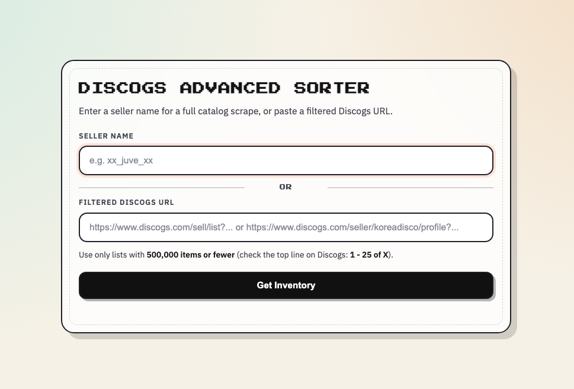

# Discogs Scraper & Advanced Sorter

## Features

- Retrieves current Marketplace data with a headless HTTP client and parallel
  cursor workers; no browser window or browser installation is required.
- Reads current Discogs `/shop/list/` filters as well as legacy `/sell/list`
  and seller-profile URLs.
- Supports filtered lists containing up to 500,000 listings, including lists
  spanning multiple sellers.
- Offers sorting options including Want, Have, Desire Gap, Rarity Score, Hot Buy, and more.

## Preview



## Requirements

- Python 3.10, 3.11, 3.12, or 3.13

## Quick Start (Recommended)

### macOS

1. Download ZIP from GitHub and unpack it.
2. Open the folder.
3. Double-click `run.command`.
4. Open `http://127.0.0.1:5080`.

### Windows

1. Download ZIP from GitHub and unpack it.
2. Open the folder.
3. Double-click `run.bat`.
4. Open `http://127.0.0.1:5080`.

The scripts create `.venv`, install dependencies, and start the app.

## Manual Start

### macOS/Linux

```bash
python3 -m venv .venv
source .venv/bin/activate
python -m pip install --upgrade pip
python -m pip install -r requirements.txt
ulimit -n 65535
flask --app app run --host 127.0.0.1 --port 5080
```

### Windows

```bat
py -3 -m venv .venv
.venv\Scripts\activate
python -m pip install --upgrade pip
python -m pip install -r requirements.txt
flask --app app run --host 127.0.0.1 --port 5080
```

## Usage

1. Input the seller name, or paste a full Discogs `/shop/list/`, legacy
   `/sell/list`, or `/seller/username/profile` URL.
2. If using URL mode, the filtered Discogs list can contain up to `500,000`
   items.
3. Click **Get Inventory**.
4. Browse the resulting table and sort columns.

If both seller and URL are filled, URL mode is used.

## Troubleshooting

- A known seller temporarily fails:
  - The sorter now distinguishes a missing seller from a Discogs security check
    or rate limit. Follow the displayed retry message instead of retyping the
    seller name.
- `Too many open files`:
  - On macOS/Linux, run `ulimit -n 65535` in the same terminal before starting.
  - The `run.command` script already applies a higher limit automatically.
- Windows says Python is not found / opens Microsoft Store / shows unsupported version:
  - Install Python 3.10, 3.11, 3.12, or 3.13 from `python.org`.
  - Disable `python.exe` and `python3.exe` in **App execution aliases**.
  - Re-run `run.bat`.
- URL mode says the URL is too broad:
  - Narrow the Discogs filters to `500,000` listings or fewer.
- Browser shows `403` on localhost:
  - Use the exact printed URL from terminal (default is `http://127.0.0.1:5080`).
  - On macOS, port `5000` can be used by system services, so this project defaults to `5080`.

## Limitations

- Discogs can still apply temporary Marketplace security checks. These are now
  reported as retryable failures instead of "seller does not exist" or an empty
  result table.
- Very large inventories can change while they are being read. The sorter
  tolerates small live-market drift but rejects materially incomplete results.
